<picture>
  <source media="(prefers-color-scheme: dark)" srcset="assets/header-dark.svg">
  
</picture>

Third-year Software Engineering student at SCE College of Engineering (Be'er Sheva, Israel). I build backend and
full-stack projects in TypeScript and Python, and teach Python part-time at [Aharai! Tech](https://aharai.org.il/enaharaitech/).

**Now building:** [Reply22](https://github.com/NadavM-ux/reply22-public), Instagram comment-to-DM automation
(NestJS, Next.js, PostgreSQL, Redis, Docker). The source is private while it's in development; the design docs are public.

## Projects

| Project | What it is | Stack |
| --- | --- | --- |
| [Reply22](https://github.com/NadavM-ux/reply22-public) | Instagram comment-to-DM automation and publishing (design docs) | TypeScript, NestJS, Next.js, PostgreSQL |
| [SeenIt](https://github.com/NadavM-ux/seenit-public) | Chrome extension, live on the [Chrome Web Store](https://chromewebstore.google.com/detail/seenit/nmfodihnijiodclibgmjimhmpoikfpge), that dims listings you've already opened on Airbnb, Yad2 and Booking.com | JavaScript |
| [Active-learning classifier](https://github.com/NadavM-ux/machine_learning_course_final_project) | Finds a target population among X/Twitter accounts (Intro to ML final project) | Python, scikit-learn |
| [ClinicVets](https://github.com/NadavM-ux/clinicvets) | Veterinary clinic management system with role-based access | C#, .NET 8 |
| [Book List API](https://github.com/NadavM-ux/book-list) | Small REST API built while learning Git workflows | Python, FastAPI |
| [C++ coursework](https://github.com/NadavM-ux/cpp-basics) | Data structures and OOP exercises | C++ |

## Tech stack

<!-- stack:start (generated by scripts/build_stack.py) -->

<a href="#tech-stack"><picture><source media="(prefers-color-scheme: dark)" srcset="assets/stack/row-1-dark.svg"></picture></a><a href="https://github.com/NadavM-ux/reply22-public" title="TypeScript: used in Reply22"><picture><source media="(prefers-color-scheme: dark)" srcset="assets/stack/typescript-dark.svg"></picture></a><a href="https://github.com/NadavM-ux/lookfinds-website" title="JavaScript: used in LookFinds"><picture><source media="(prefers-color-scheme: dark)" srcset="assets/stack/javascript-dark.svg"></picture></a><a href="https://github.com/NadavM-ux/machine_learning_course_final_project" title="Python: used in my ML project"><picture><source media="(prefers-color-scheme: dark)" srcset="assets/stack/python-dark.svg"></picture></a><a href="https://dev.java" title="Java: official site"><picture><source media="(prefers-color-scheme: dark)" srcset="assets/stack/java-dark.svg"></picture></a><a href="https://github.com/NadavM-ux/cpp-basics" title="C++: my C++ coursework"><picture><source media="(prefers-color-scheme: dark)" srcset="assets/stack/cpp-dark.svg"></picture></a><a href="https://en.cppreference.com/w/c" title="C: reference"><picture><source media="(prefers-color-scheme: dark)" srcset="assets/stack/c-dark.svg"></picture></a><a href="https://github.com/NadavM-ux/clinicvets" title="C#: used in ClinicVets"><picture><source media="(prefers-color-scheme: dark)" srcset="assets/stack/csharp-dark.svg"></picture></a> 
<a href="#tech-stack"><picture><source media="(prefers-color-scheme: dark)" srcset="assets/stack/row-2-dark.svg"></picture></a><a href="https://github.com/NadavM-ux/reply22-public" title="Node.js: used in Reply22"><picture><source media="(prefers-color-scheme: dark)" srcset="assets/stack/nodejs-dark.svg"></picture></a><a href="https://github.com/NadavM-ux/reply22-public" title="NestJS: used in Reply22"><picture><source media="(prefers-color-scheme: dark)" srcset="assets/stack/nestjs-dark.svg"></picture></a><a href="https://github.com/NadavM-ux/book-list" title="FastAPI: used in Book List API"><picture><source media="(prefers-color-scheme: dark)" srcset="assets/stack/fastapi-dark.svg"></picture></a><a href="https://github.com/NadavM-ux/reply22-public" title="PostgreSQL: used in Reply22"><picture><source media="(prefers-color-scheme: dark)" srcset="assets/stack/postgresql-dark.svg"></picture></a><a href="https://www.mysql.com" title="MySQL: official site"><picture><source media="(prefers-color-scheme: dark)" srcset="assets/stack/mysql-dark.svg"></picture></a><a href="https://github.com/NadavM-ux/reply22-public" title="Redis: used in Reply22"><picture><source media="(prefers-color-scheme: dark)" srcset="assets/stack/redis-dark.svg"></picture></a> 
<a href="#tech-stack"><picture><source media="(prefers-color-scheme: dark)" srcset="assets/stack/row-3-dark.svg"></picture></a><a href="https://github.com/NadavM-ux/reply22-public" title="React: used in Reply22"><picture><source media="(prefers-color-scheme: dark)" srcset="assets/stack/react-dark.svg"></picture></a><a href="https://github.com/NadavM-ux/reply22-public" title="Next.js: used in Reply22"><picture><source media="(prefers-color-scheme: dark)" srcset="assets/stack/nextjs-dark.svg"></picture></a><a href="https://github.com/NadavM-ux/lookfinds-website" title="Tailwind CSS: used in LookFinds"><picture><source media="(prefers-color-scheme: dark)" srcset="assets/stack/tailwind-css-dark.svg"></picture></a><a href="https://github.com/NadavM-ux/devloops" title="HTML5: used in DevLoops pages"><picture><source media="(prefers-color-scheme: dark)" srcset="assets/stack/html5-dark.svg"></picture></a><a href="https://github.com/NadavM-ux/lookfinds-website" title="CSS: used in LookFinds"><picture><source media="(prefers-color-scheme: dark)" srcset="assets/stack/css-dark.svg"></picture></a> 
<a href="#tech-stack"><picture><source media="(prefers-color-scheme: dark)" srcset="assets/stack/row-4-dark.svg"></picture></a><a href="https://github.com/NadavM-ux/machine_learning_course_final_project" title="scikit-learn: used in my ML project"><picture><source media="(prefers-color-scheme: dark)" srcset="assets/stack/scikit-learn-dark.svg"></picture></a><a href="https://github.com/NadavM-ux/machine_learning_course_final_project" title="pandas: used in my ML project"><picture><source media="(prefers-color-scheme: dark)" srcset="assets/stack/pandas-dark.svg"></picture></a><a href="https://github.com/NadavM-ux/machine_learning_course_final_project" title="NumPy: used in my ML project"><picture><source media="(prefers-color-scheme: dark)" srcset="assets/stack/numpy-dark.svg"></picture></a><a href="https://opencv.org" title="OpenCV: official site"><picture><source media="(prefers-color-scheme: dark)" srcset="assets/stack/opencv-dark.svg"></picture></a><a href="https://github.com/NadavM-ux/machine_learning_course_final_project" title="Jupyter: used in my ML project"><picture><source media="(prefers-color-scheme: dark)" srcset="assets/stack/jupyter-dark.svg"></picture></a> 
<a href="#tech-stack"><picture><source media="(prefers-color-scheme: dark)" srcset="assets/stack/row-5-dark.svg"></picture></a><a href="https://github.com/NadavM-ux/book-list" title="Git: Book List API, built to practise Git workflows"><picture><source media="(prefers-color-scheme: dark)" srcset="assets/stack/git-dark.svg"></picture></a><a href="https://github.com/NadavM-ux/reply22-public" title="GitHub Actions: used in Reply22"><picture><source media="(prefers-color-scheme: dark)" srcset="assets/stack/github-actions-dark.svg"></picture></a><a href="https://github.com/NadavM-ux/reply22-public" title="Docker: used in Reply22"><picture><source media="(prefers-color-scheme: dark)" srcset="assets/stack/docker-dark.svg"></picture></a><a href="https://www.kernel.org" title="Linux: official site"><picture><source media="(prefers-color-scheme: dark)" srcset="assets/stack/linux-dark.svg"></picture></a><a href="https://claude.com/claude-code" title="Claude Code: official site"><picture><source media="(prefers-color-scheme: dark)" srcset="assets/stack/claude-code-dark.svg"></picture></a> 
<a href="#tech-stack"><picture><source media="(prefers-color-scheme: dark)" srcset="assets/stack/row-6-dark.svg"></picture></a><a href="https://github.com/NadavM-ux/lookfinds-website" title="Vercel: LookFinds is deployed on Vercel"><picture><source media="(prefers-color-scheme: dark)" srcset="assets/stack/vercel-dark.svg"></picture></a><a href="https://github.com/NadavM-ux/reply22-public" title="Cloudflare: used in Reply22"><picture><source media="(prefers-color-scheme: dark)" srcset="assets/stack/cloudflare-dark.svg"></picture></a><a href="https://www.raspberrypi.com" title="Raspberry Pi: official site"><picture><source media="(prefers-color-scheme: dark)" srcset="assets/stack/raspberry-pi-dark.svg"></picture></a> 
<a href="#tech-stack"><picture><source media="(prefers-color-scheme: dark)" srcset="assets/stack/row-7-dark.svg"></picture></a><a href="https://www.adobe.com/products/photoshop.html" title="Photoshop: official site"><picture><source media="(prefers-color-scheme: dark)" srcset="assets/stack/photoshop-dark.svg"></picture></a><a href="https://www.adobe.com/products/premiere.html" title="Premiere Pro: official site"><picture><source media="(prefers-color-scheme: dark)" srcset="assets/stack/premiere-pro-dark.svg"></picture></a><a href="https://www.adobe.com/products/aftereffects.html" title="After Effects: official site"><picture><source media="(prefers-color-scheme: dark)" srcset="assets/stack/after-effects-dark.svg"></picture></a><a href="https://www.blender.org" title="Blender: official site"><picture><source media="(prefers-color-scheme: dark)" srcset="assets/stack/blender-dark.svg"></picture></a>

<!-- stack:end -->

## Contact

[LinkedIn](https://www.linkedin.com/in/nadav-magen-182311323/) · magennadav32@gmail.com
